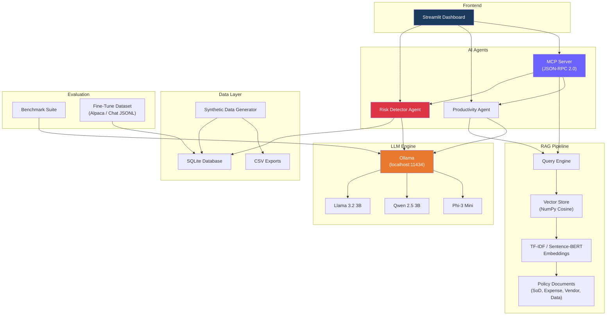

<p align="center">
  
  
  
  
  
  
</p>

<h1 align="center">🛡️ ERP-Sentry</h1>
<p align="center">
  <strong>AI-Powered ERP Risk Intelligence — 100 % Local, 100 % Private</strong><br>
  Segregation of Duties detection, policy Q&A, productivity tools, and model benchmarking<br>
  powered entirely by local LLMs via Ollama.
</p>

---

## 🎯 Overview

**ERP-Sentry** demonstrates how local large language models can transform ERP compliance and internal productivity — without sending a single byte of sensitive data to the cloud.

Built for the **iRM internship application**, this project showcases:

| # | Capability | Implementation |
|---|-----------|---------------|
| 1 | **Local LLMs** | Ollama on Windows (Llama 3.2 3B, Qwen 2.5, Phi-3) |
| 2 | **ERP Risk Detection** | SoD violation scanner + LLM-powered risk assessments |
| 3 | **Policy Q&A (RAG)** | TF-IDF vector store + retrieval-augmented generation |
| 4 | **Productivity Tools** | Summarise, draft emails, meeting notes |
| 5 | **AI Agents (MCP)** | JSON-RPC 2.0 MCP server exposing ERP tools |
| 6 | **Benchmarking** | Tokens/sec, TTFT, VRAM, per-category comparison |
| 7 | **Synthetic Data** | Realistic ERP transactions with injected violations |
| 8 | **Fine-Tuning Prep** | LoRA/QLoRA dataset in Alpaca & chat formats |

---

## 🏗️ Architecture



---

## 📁 Project Structure

```
ERP-Sentry/
├── config.py                       # Central configuration
├── setup_check.py                  # Environment verification
├── requirements.txt                # Dependencies
├── README.md
│
├── data/
│   └── generate_synthetic_erp.py   # Synthetic ERP data generator
│
├── rag/
│   ├── embeddings.py               # TF-IDF / sentence-transformer embeddings
│   ├── query_engine.py             # RAG query pipeline
│   └── policies/
│       ├── sod_policy.txt
│       ├── expense_policy.txt
│       ├── vendor_management_policy.txt
│       └── data_access_policy.txt
│
├── agents/
│   ├── risk_detector.py            # SoD & anomaly detection agent
│   ├── productivity_agent.py       # Summarise, email, meeting notes
│   ├── mcp_server.py              # MCP server (JSON-RPC over stdio)
│   └── mcp_client.py             # MCP client demo
│
├── benchmark/
│   ├── run_benchmark.py           # Multi-model benchmark suite
│   └── benchmark_tasks.json       # Pre-defined test prompts
│
├── finetuning/
│   ├── prepare_dataset.py         # LoRA dataset preparation
│   └── finetune_guide.md          # Step-by-step fine-tuning guide
│
├── app/
│   └── dashboard.py               # Streamlit web dashboard
│
└── notebooks/
    ├── 01_local_llm_setup.py      # Ollama setup walkthrough
    ├── 02_rag_demo.py             # RAG pipeline demo
    ├── 03_sod_detection.py        # SoD detection walkthrough
    └── 04_benchmarking.py         # Model comparison
```

---

## 🚀 Quick Start

### Prerequisites

- **Windows 10/11** with Python 3.10+
- **NVIDIA GPU** (RTX 3050 or better) with latest drivers
- **Ollama** installed → [ollama.com/download](https://ollama.com/download)

### 1. Install Dependencies

```bash
cd ERP-Sentry
pip install -r requirements.txt
```

### 2. Pull Models

```bash
ollama pull llama3.2:3b
ollama pull qwen2.5:3b
# Optional:
ollama pull llama3.2:1b
ollama pull phi3:mini
```

### 3. Verify Setup

```bash
python setup_check.py
```

### 4. Generate Synthetic Data

```bash
python -m data.generate_synthetic_erp
```

### 5. Build RAG Index

```bash
python -m rag.embeddings
```

### 6. Launch Dashboard

```bash
streamlit run app/dashboard.py
```

---

## 🔍 Feature Deep-Dives

### ERP Risk Scanner

Detects Segregation of Duties violations and transaction anomalies:

- **SoD Conflicts**: Same user holding `CREATE_PURCHASE_ORDER` + `APPROVE_PAYMENT`
- **Off-Hours Activity**: Transactions at 2 AM or on weekends
- **High-Amount Flags**: Transactions exceeding $50K threshold
- **LLM Enrichment**: Each finding gets a natural-language risk assessment

```bash
python -m agents.risk_detector
```

<!--  -->

### RAG Policy Q&A

Ask natural-language questions over company policy documents:

```bash
python -m rag.query_engine
```

```
❓ What expenses require CFO approval?
💬 According to the Expense Approval Policy, expenses exceeding $25,000
   require VP of Finance + CFO approval, and expenses over $50,000
   require CFO + Board Approval.
📚 Source: expense_policy.txt (score: 0.8742)
```

### MCP Server

Expose ERP-Sentry as tools for any MCP-compatible AI client:

```bash
# Start server
python -m agents.mcp_server

# Demo client
python -m agents.mcp_client
```

**Tools exposed**: `query_erp_transactions`, `check_sod_violations`, `search_policies`, `summarize_text`

### Model Benchmarking

```bash
python -m benchmark.run_benchmark
```

| Model | Avg tok/s | Avg TTFT | Avg Latency |
|-------|-----------|----------|-------------|
| llama3.2:3b | ~25 | ~0.8s | ~12s |
| qwen2.5:3b | ~22 | ~0.9s | ~14s |
| llama3.2:1b | ~45 | ~0.4s | ~6s |

*(Results vary by hardware. Run the benchmark for your own numbers.)*

<!--  -->

### Fine-Tuning Preparation

```bash
python -m finetuning.prepare_dataset
```

Generates Alpaca-format and chat-format JSONL datasets for LoRA/QLoRA fine-tuning. See [`finetuning/finetune_guide.md`](finetuning/finetune_guide.md) for the complete guide.

---

## 🖥️ Streamlit Dashboard

The dashboard ties everything together with 5 tabs:

| Tab | Description |
|-----|-------------|
| 🔍 ERP Risk Scanner | Run SoD scans, view findings with LLM explanations |
| 📚 Policy Q&A | RAG-powered questions over company policies |
| ⚡ Productivity | Summarise text, draft emails, meeting notes |
| 📊 Benchmarks | Model comparison charts and tables |
| 🔌 MCP Server | Tool definitions, test calls, Claude Desktop config |

<!--  -->

---

## 🔧 Configuration

All settings are in [`config.py`](config.py). Key options:

| Setting | Default | Description |
|---------|---------|-------------|
| `OLLAMA_BASE_URL` | `http://127.0.0.1:11434` | Ollama endpoint |
| `DEFAULT_MODEL` | `llama3.2:3b` | Primary model |
| `EMBEDDING_BACKEND` | `tfidf` | `tfidf` or `sentence-transformers` |
| `HIGH_AMOUNT_THRESHOLD` | `50,000` | USD amount flag threshold |
| `RAG_TOP_K` | `3` | Number of retrieved chunks |

---

## 🛡️ Security & Privacy

- **Zero cloud dependency** — all inference runs locally via Ollama
- **No data exfiltration** — sensitive ERP data never leaves the machine
- **Synthetic data only** — demo uses generated data, not real records
- **Configurable thresholds** — tune detection sensitivity per environment

---

## 📝 License

This project is for demonstration and educational purposes as part of the
iRM internship application. All code is original.

---

<p align="center">
  <strong>Built with ❤️ for iRM</strong><br>
  <em>Demonstrating the power of local AI for enterprise compliance</em>
</p>
