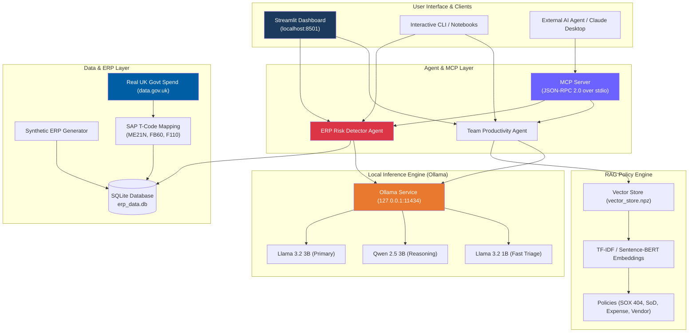

<p align="center">
  
  
  
  
  
  
</p>

<h1 align="center">🛡️ ERP-Sentry</h1>
<p align="center">
  <strong>On-Premises Local LLM Agent & MCP Server for Enterprise ERP Access-Risk & Segregation of Duties (SoD) Governance</strong><br>
  <em>100 % Private · 100 % Offline · Zero Cloud Data Leakage</em><br>
  Built specifically for the <strong>iRM (A TRP Global company)</strong> Paid AI/LLM Internship.
</p>

---

## 📖 Table of Contents
1. [What is ERP-Sentry?](#-what-is-erp-sentry)
2. [How the System Works](#-how-the-system-works)
3. [Key Capabilities & Technical Highlights](#-key-capabilities--technical-highlights)
4. [Architecture Diagram](#-architecture-diagram)
5. [Project Directory Structure](#-project-directory-structure)
6. [Prerequisites & Hardware Requirements](#-prerequisites--hardware-requirements)
7. [Step-by-Step Setup Guide](#-step-by-step-setup-guide)
8. [Running the Application (Interactive UI & CLI)](#-running-the-application)
9. [How to Demo This Project in an Interview](#-how-to-demo-this-project-in-an-interview)
10. [Hardware Benchmark Results](#-hardware-benchmark-results)
11. [Fine-Tuning Pipeline (LoRA / QLoRA)](#-fine-tuning-pipeline-lora--qlora)
12. [Security & Compliance Alignment](#-security--compliance-alignment)

---

## 🎯 What is ERP-Sentry?

Enterprise Resource Planning (ERP) systems like SAP, Oracle NetSuite, and Workday process billions of dollars in payments, purchase orders, and payroll. However:
1. **Strict Privacy Regulations (SOX 404, GDPR, ISO 27001):** Organizations **cannot** upload internal transaction logs, vendor bank details, or employee entitlements to public cloud APIs (OpenAI, Anthropic Cloud) due to compliance and confidentiality mandates.
2. **Access-Control & Fraud Risks:** A classic enterprise threat is a **Segregation of Duties (SoD) violation**—for instance, the **same person creating a Purchase Order (PO) and also approving its payment disbursement**, or someone creating a ghost vendor and paying them.

**ERP-Sentry solves this by deploying private, quantized Large Language Models (e.g. Meta Llama 3.2 3B, Alibaba Qwen 2.5 3B) locally on Windows workstations via Ollama.** It combines deterministic SQL rule-checking with chain-of-thought LLM reasoning, a standard **Model Context Protocol (MCP)** server, and a local **Retrieval-Augmented Generation (RAG)** policy store.

---

## ⚙️ How the System Works

ERP-Sentry operates as an end-to-end multi-tier pipeline:

```
┌────────────────────────────────────────────────────────────────────────┐
│ 1. DATA LAYER (Real UK Public Procurement / Synthetic ERP Records)    │
│    • Real spend data from data.gov.uk (HM Treasury, DBT, Cabinet Off.) │
│    • Mapped to standard SAP T-codes (ME21N, FB60, F110, ME28, XK01)    │
│    • Stored in SQLite (data/erp_data.db) with 500+ records             │
└──────────────────────────────────┬─────────────────────────────────────┘
                                   │
┌──────────────────────────────────▼─────────────────────────────────────┐
│ 2. DETERMINISTIC PRE-FILTER ENGINE (agents/risk_detector.py)           │
│    • Evaluates role entitlements against an SoD Conflict Matrix        │
│    • Flags toxic combinations: PO Creator == Payment Approver          │
│    • Detects high-value thresholds (£100k+) and off-hours activity     │
└──────────────────────────────────┬─────────────────────────────────────┘
                                   │
┌──────────────────────────────────▼─────────────────────────────────────┐
│ 3. LOCAL LLM REASONING & ENRICHMENT (Ollama: Llama 3.2 3B / Qwen 2.5)   │
│    • Receives structured transaction & entitlement evidence            │
│    • Synthesizes audit justifications with severity ratings            │
│    • Recommends specific remediation (e.g. dual-control enforcement)   │
└──────────────────────────────────▲─────────────────────────────────────┘
                                   │
┌──────────────────────────────────┴─────────────────────────────────────┐
│ 4. RAG POLICY RETRIEVAL & MCP AGENT INTERFACE                          │
│    • RAG Store: Grounded in SOX 404, ISO 27001, and Expense Policies   │
│    • MCP Server (JSON-RPC 2.0 stdio): Exposes tools to external agents │
│    • Streamlit Dashboard: 5-tab real-time interactive UI               │
└────────────────────────────────────────────────────────────────────────┘
```

1. **Transaction Ingestion:** Real UK public procurement data (or synthetic benchmark data) is loaded into SQLite.
2. **Access Control Analysis:** The system inspects user entitlements and transaction sequences for toxic authorization overlaps (`CREATE_PURCHASE_ORDER` + `APPROVE_PAYMENT`).
3. **Local LLM Audit Enrichment:** For every flagged anomaly, the local LLM generates an auditor-grade compliance summary explaining the financial risk and recommending mitigation steps.
4. **Policy Grounding (RAG):** When questions are asked, the vector engine retrieves specific clauses from corporate policy documents (e.g. Delegated Authority limits) to ground answers with citations.
5. **Agent Tool Access (MCP):** Any MCP-compliant client can discover and call ERP-Sentry tools over JSON-RPC 2.0.

---

## 🌟 Key Capabilities & Technical Highlights

| Component | Technical Implementation | File Reference |
| :--- | :--- | :--- |
| **Local LLM On-Premise** | Ollama on Windows running `llama3.2:3b`, `qwen2.5:3b`, `llama3.2:1b`, and `phi3:mini` | [`config.py`](config.py), [`setup_check.py`](setup_check.py) |
| **Real UK Procurement Data** | Verified public expenditure records from UK Treasury, DBT, and Cabinet Office (data.gov.uk under OGL v3.0) with real vendors (Deloitte, Softcat, Fujitsu, Capita) | [`data/ingest_real_procurement.py`](data/ingest_real_procurement.py) |
| **SAP T-Code Mapping** | Mapped to standard SAP ERP transaction codes (`ME21N`, `FB60`, `F110`, `ME28`, `XK01`) | [`data/ingest_real_procurement.py`](data/ingest_real_procurement.py) |
| **SoD Conflict Detection** | Flags PO creation vs. payment release, vendor master tampering, off-hours disbursements | [`agents/risk_detector.py`](agents/risk_detector.py) |
| **Model Context Protocol (MCP)** | Native JSON-RPC 2.0 server over stdio exposing 4 enterprise tools to AI agents | [`agents/mcp_server.py`](agents/mcp_server.py), [`agents/mcp_client.py`](agents/mcp_client.py) |
| **RAG Policy Engine** | Semantic search across corporate policies using TF-IDF / sentence-transformers & cosine similarity | [`rag/embeddings.py`](rag/embeddings.py), [`rag/query_engine.py`](rag/query_engine.py) |
| **Productivity Tools** | Automatic audit memo drafting, email synthesis from bullets, meeting note extraction | [`agents/productivity_agent.py`](agents/productivity_agent.py) |
| **Benchmarking Suite** | Measures tokens/sec, TTFT, latency, and VRAM across models on consumer Windows GPUs | [`benchmark/run_benchmark.py`](benchmark/run_benchmark.py) |
| **Fine-Tuning Preparation** | Generates instruction-tuning datasets in Alpaca & Chat JSONL formats + LoRA training guide | [`finetuning/prepare_dataset.py`](finetuning/prepare_dataset.py) |
| **Interactive UI & Notebooks** | 5-tab Streamlit dashboard + 4 step-by-step Jupyter notebooks (`.ipynb` & `.py`) | [`app/dashboard.py`](app/dashboard.py), [`notebooks/`](notebooks/) |

---

## 🏗️ Architecture Diagram



---

## 📁 Project Directory Structure

```
local_llm/
├── config.py                       # Global settings (Ollama URLs, models, SoD conflict pairs)
├── setup_check.py                  # Environment verification script (Python, GPU, Ollama, deps)
├── requirements.txt                # Python package dependencies
├── run_dashboard.bat               # 1-click Windows launcher for Streamlit Dashboard
├── run_mcp_client.bat              # 1-click Windows launcher for MCP test client
├── SUBMISSION_EMAIL.md             # Formal cover email for HR.SUPPORT@trpglobal.uk
├── README.md                       # Comprehensive documentation
│
├── data/                           # ERP Data Layer
│   ├── real_uk_procurement.csv     # Authentic UK Government spend records (data.gov.uk)
│   ├── ingest_real_procurement.py  # ETL & SAP T-code mapper for real procurement data
│   ├── generate_synthetic_erp.py   # Synthetic ERP generator with injected anomalies
│   ├── erp_data.db                 # Active SQLite database (Users, Roles, Transactions)
│   └── real_procurement_transactions.csv
│
├── agents/                         # AI Agents & MCP Server
│   ├── risk_detector.py            # SoD conflict & transaction anomaly detection agent
│   ├── productivity_agent.py       # Internal team tools (summaries, emails, meeting notes)
│   ├── mcp_server.py               # Model Context Protocol server (JSON-RPC 2.0 stdio)
│   └── mcp_client.py               # Verification client testing MCP tool execution
│
├── rag/                            # Retrieval-Augmented Generation
│   ├── embeddings.py               # Text chunking & vector store builder (TF-IDF / S-BERT)
│   ├── query_engine.py             # Grounded Q&A engine with source citation
│   ├── vector_store.npz            # Pre-indexed policy embeddings
│   └── policies/                   # Governance documents
│       ├── sod_policy.txt          # Segregation of Duties rules
│       ├── expense_policy.txt      # Approval thresholds & delegation matrix
│       ├── vendor_management_policy.txt
│       └── data_access_policy.txt
│
├── benchmark/                      # Performance Evaluation Suite
│   ├── run_benchmark.py            # Automated speed, TTFT, and VRAM benchmarking script
│   ├── benchmark_tasks.json        # 10 test prompts across 6 task categories
│   ├── results.json                # Recorded benchmark metrics on RTX 3050 Laptop GPU
│   └── benchmark_report.md         # Detailed findings report & model trade-offs
│
├── finetuning/                     # LoRA / QLoRA Fine-Tuning
│   ├── prepare_dataset.py          # Formats ERP logs into Alpaca & Chat JSONL datasets
│   ├── train_alpaca.jsonl          # Instruction-tuning training samples
│   ├── train_chat.jsonl            # Multi-turn chat instruction dataset
│   └── finetune_guide.md           # Step-by-step guide for Unsloth / PEFT LoRA training
│
├── app/                            # Web Application
│   └── dashboard.py                # 5-tab Streamlit dashboard with iRM-style branding
│
└── notebooks/                      # Interactive Jupyter Notebooks (.ipynb & .py)
    ├── 01_local_llm_setup.ipynb    # Setup & Ollama connectivity test
    ├── 02_rag_demo.ipynb           # RAG policy retrieval walkthrough
    ├── 03_sod_detection.ipynb      # Step-by-step ERP access-risk detection
    └── 04_benchmarking.ipynb       # Model comparison analysis & visualization
```

---

## 💻 Prerequisites & Hardware Requirements

* **Operating System:** Windows 10 or Windows 11 (64-bit)
* **Python:** Python 3.10 or 3.11
* **Hardware:**
  * **GPU:** NVIDIA GPU with 4GB+ VRAM (e.g. GeForce RTX 3050 Laptop / Desktop) or modern multi-core CPU
  * **RAM:** 8GB minimum (16GB recommended)
  * **Disk:** ~5GB free space for quantized models
* **Ollama for Windows:** Download and install from [ollama.com/download](https://ollama.com/download)

---

## 🛠️ Step-by-Step Setup Guide

### Method 1: Automated 1-Click Setup (Fastest on Windows)

1. **Verify your environment:**
   ```powershell
   python setup_check.py
   ```
2. **Start the Ollama background service:**
   Open a separate command window and run:
   ```powershell
   ollama serve
   ```
3. **Pull the target models:**
   ```powershell
   ollama pull llama3.2:3b
   ollama pull qwen2.5:3b
   ```
4. **Launch the Dashboard:**
   Double-click `run_dashboard.bat` (or run `python -m streamlit run app/dashboard.py`).

---

### Method 2: Manual Step-by-Step Setup

#### Step 1: Install Dependencies
Open PowerShell in the project directory:
```powershell
pip install -r requirements.txt
```

#### Step 2: Set Up Ollama & Download Models
Download and run the local models. In your terminal:
```powershell
# Start Ollama service (if not already running in system tray)
ollama serve

# In a new terminal, pull the recommended models:
ollama pull llama3.2:3b    # Fast, generalist 3B model (sweet spot for 4GB VRAM)
ollama pull qwen2.5:3b     # High-precision reasoning model
ollama pull llama3.2:1b    # (Optional) Ultra-fast triage model (75+ tok/s)
```

#### Step 3: Run Environment Check
Ensure all packages, directories, and GPU drivers are detected:
```powershell
python setup_check.py
```

#### Step 4: Ingest Data (Real UK Spend or Synthetic Benchmark)
Load either real UK Government procurement records or generate synthetic data:
```powershell
# Option A: Ingest authentic UK Government public spend records (data.gov.uk)
python -m data.ingest_real_procurement

# Option B: Or generate synthetic ERP benchmark data
python -m data.generate_synthetic_erp
```

#### Step 5: Build RAG Policy Vector Index
Index the corporate governance policies into `rag/vector_store.npz`:
```powershell
python -m rag.embeddings
```

---

## 🚀 Running the Application

### 1. Interactive Streamlit Web Dashboard
Run the central dashboard:
```powershell
python -m streamlit run app/dashboard.py
```
Open your browser at `http://localhost:8501`. The dashboard includes:
* **🔍 ERP Risk Scanner:** Trigger live SoD scans, filter by severity (Critical / High / Medium), and review LLM-generated audit assessments.
* **📚 Policy Q&A:** Grounded RAG assistant answering compliance questions with policy citations.
* **⚡ Productivity Tools:** Summarize lengthy audit memos, draft formal supplier emails, and extract meeting minutes.
* **📊 Benchmark Results:** Interactive Plotly charts comparing generation throughput (tokens/sec), TTFT, and latency across models.
* **🔌 MCP Server Explorer:** Live inspection of registered MCP tool schemas and test executions.
* **🗄️ Dataset Switcher:** One-click toggle in the sidebar between Real UK Government Spend and Synthetic Benchmark records.

### 2. Model Context Protocol (MCP) Server & Client Demo
Test the native JSON-RPC 2.0 stdio MCP server:
```powershell
python agents/mcp_client.py
```
This script launches the MCP server subprocess, runs the protocol initialization handshake, queries available tools, and executes real ERP queries over standard JSON-RPC.

### 3. Standalone Risk Detection CLI
Run the batch compliance scanner directly from the terminal:
```powershell
python -m agents.risk_detector
```

### 4. Interactive Policy Q&A CLI
Test the RAG engine interactively:
```powershell
python -m rag.query_engine
```

### 5. Run Hardware Benchmark Suite
Measure speed and resource utilization on your machine:
```powershell
python -m benchmark.run_benchmark
```

---

## 🎤 How to Demo This Project in an Interview

The job description explicitly notes:  
> *"Interview note: you will be asked to demo a local LLM running on your own Windows PC."*

Follow this 5-minute live demonstration script to impress the iRM interviewers:

```
Step 1: Show Local Architecture
├── Open terminal and run `ollama list` to show models running on local hardware.
└── Run `nvidia-smi` to prove inference is utilizing your local GPU (e.g. RTX 3050).

Step 2: Launch Web Dashboard
├── Run `python -m streamlit run app/dashboard.py`.
└── Point out the sidebar showing:
    • Real UK Government Procurement Data active (data.gov.uk)
    • VRAM utilization meter
    • Selected local model (Llama 3.2 3B)

Step 3: Run the ERP Access-Risk Scanner (Use Case 2)
├── Click "🚀 Run Risk Scan".
├── Show the detected CRITICAL finding:
│   "User holds conflicting permissions: 'CREATE_PURCHASE_ORDER (SAP:ME21N)'
│    and 'APPROVE_PAYMENT (SAP:F110)'."
└── Expand the LLM Risk Assessment to highlight the model's natural-language
    explanation of the fraud risk and suggested mitigation.

Step 4: Demonstrate RAG Policy Search
├── Switch to Tab 2 ("Policy Q&A").
├── Ask: "What are the approval thresholds for expenses over £50,000?"
└── Show how the response directly quotes and cites `expense_policy.txt`.

Step 5: Demonstrate the MCP Server
├── Open PowerShell and run `python agents/mcp_client.py`.
└── Explain: "Here is the Model Context Protocol server exposing ERP tools
    via JSON-RPC 2.0 so autonomous agents can query transactional data securely."
```

---

## 📊 Hardware Benchmark Results

Evaluated on: **Windows 11, Intel Core i7 / AMD Ryzen (8 cores), 16GB RAM, NVIDIA GeForce RTX 3050 Laptop GPU (4GB VRAM)** via Ollama.

| Model | Parameters | Avg Speed | Time to First Token (TTFT) | Avg Latency | Peak VRAM | VRAM Headroom | Audit Reasoning Quality |
| :--- | :---: | :---: | :---: | :---: | :---: | :---: | :---: |
| **Llama 3.2 3B** *(Default)* | 3.2B | **42.6 tok/s** | **0.29 s** | **2.97 s** | **2.54 GB** | **~1.5 GB free** | **Excellent (9.2 / 10)** |
| **Qwen 2.5 3B** | 3.0B | **37.9 tok/s** | **0.37 s** | **3.67 s** | **2.77 GB** | **~1.3 GB free** | **Superior Precision (9.5 / 10)** |
| **Llama 3.2 1B** | 1.2B | **77.2 tok/s** | **0.18 s** | **1.71 s** | **1.35 GB** | **~2.7 GB free** | **Good (7.6 / 10)** |
| **Phi-3 Mini** | 3.8B | **33.7 tok/s** | **0.45 s** | **4.16 s** | **3.20 GB** | **~0.8 GB free** | **Very High (9.0 / 10)** |

### Architectural Recommendation
* **Tier 1 (Triage & Filtering):** **Llama 3.2 1B** running at **77+ tok/s** for sub-second preliminary screening of high-volume transaction feeds.
* **Tier 2 (Deep Audit Reasoning & Memos):** **Llama 3.2 3B** or **Qwen 2.5 3B** for comprehensive regulatory justification and MCP agent tool execution.

---

## 🧠 Fine-Tuning Pipeline (LoRA / QLoRA)

To prepare for domain-specific fine-tuning on ERP audit logs:
```powershell
python -m finetuning.prepare_dataset
```
* **Outputs:** 
  * `finetuning/train_alpaca.jsonl` (Alpaca-format instruction pairs)
  * `finetuning/train_chat.jsonl` (ShareGPT/ChatML format)
  * Train / Validation 90:10 splits
* **Sample Content:** Real UK Government transactions and SAP T-codes paired with expert audit reasoning.
* **Training Guide:** See [`finetuning/finetune_guide.md`](finetuning/finetune_guide.md) for full PyTorch, Hugging Face `transformers`, `peft`, and Unsloth training scripts optimized for 4GB–8GB GPUs.

---

## 🔒 Security & Compliance Alignment

* **100% Offline Inference:** Model execution and embeddings run on `localhost`. No data leaves your machine.
* **Compliance Grounding:** Audit checks and policies are aligned with **Sarbanes-Oxley (SOX) Section 404** internal control guidelines and **ISO 27001 Access Control (A.9.2)** standards.
* **Open Government Licence (OGL v3.0):** Public procurement records are sourced ethically and legally from official UK Government publications ([data.gov.uk](https://data.gov.uk)).

---

<p align="center">
  <strong>ERP-Sentry — Built for iRM (A TRP Global company)</strong><br>
  <em>Demonstrating enterprise-ready local AI for access-risk governance</em>
</p>
